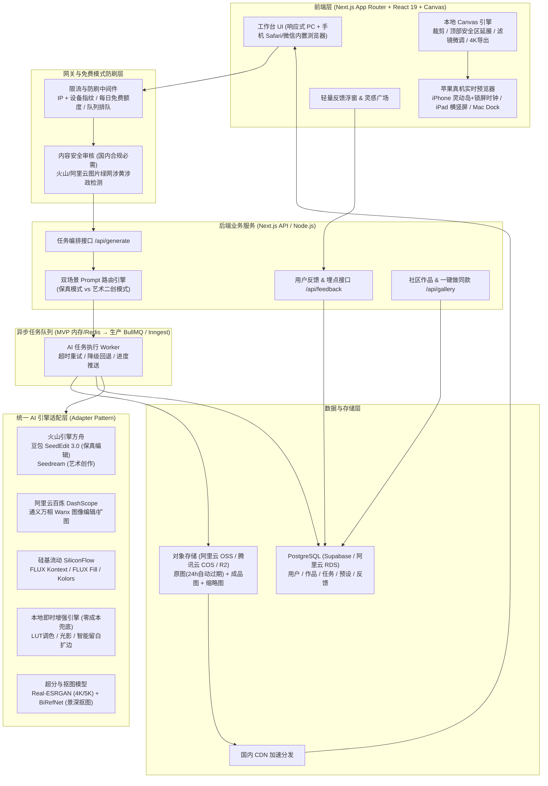

# 果壁 Studio (AppleWall Studio) — 完整技术架构设计

> **定位**：面向国内苹果用户的**免费、零门槛** AI 壁纸工作室，同时覆盖「真人/宠物高保真美化」与「风景/艺术壁纸二次创作」，专注解决苹果生态（iPhone / iPad / Mac）的分辨率、锁屏安全区、景深效果与三端套图联动痛点。

---

## 1. 系统整体架构图



---

## 2. 双核心场景的 AI 路由策略（最关键的技术差异）

不同场景不能用同一套模型和参数，否则“人像会变脸”或“艺术感不够强”：

### 场景 A：真人 / 宠物照片美化（强原图一致性）
- **用户核心诉求**：人还是那个人、猫还是那只猫，只是光线更通透、背景更干净、构图更适合当壁纸，不要“AI 换脸”！
- **模型选型（国内首选）**：
  1. **火山引擎 豆包 `SeedEdit 3.0`**（目前国内对人物五官、宠物毛发保持度极高，且原生理解中文美学提示词）
  2. **硅基流动 `FLUX.1 Kontext`**（指令式精准编辑，保真度极佳）
  3. **阿里百炼 `Wanx Image Edit`**（擅长背景替换、路人消除、光影重打）
- **核心参数与管线**：
  - `denoising_strength / guidance` 控制在低重绘区间（0.25 ~ 0.45），锁定主体结构。
  - **顶部安全区智能扩图（Outpainting）**：不改变主体，仅将画布向上延展 22%（补全天空/墙面/虚化散景），让 iPhone 锁屏时间完整落在干净区域。
  - **景深主体抠图（BiRefNet / RMBG-2.0）**：提取前景透明通道，在前端预览器模拟 iOS 景深效果，并提示用户“该构图是否容易触发真机景深”。

### 场景 B：风景 / 艺术壁纸二次创作（强风格美学）
- **用户核心诉求**：把随手拍的普通街景、晚霞、桌面变成高级感满满的新海诚动漫、苹果官方流体极简、电影胶片或 OLED 深邃暗黑壁纸。
- **模型选型（国内首选）**：
  1. **火山引擎 豆包 `Seedream` / 阿里通义万相风格重绘**
  2. **硅基流动 `FLUX Dev + 风格 LoRA` / `Kolors`**
- **核心参数与管线**：
  - 较高重绘自由度（0.55 ~ 0.78），保留大构图线条（ControlNet Depth/Canny 或 Image-to-Image），大幅重塑色彩、笔触与氛围光影。
  - **三端全景延展**：先生成居中核心画幅，再针对 iPhone (9:19.5) 上下扩图、针对 Mac (16:10) 左右扩图，保证三台苹果设备视觉浑然一体。

---

## 3. 「免费开放模式」的成本控制与防刷架构

因为现阶段坚持**完全免费、先聚拢用户与真实反馈**，最怕的不是没人用，而是突然在小红书爆了之后被刷爆 API 账单。架构上内置 5 层护城河：

1. **两段式算力消耗（省 70% 费用）**：
   - 第 1 步（调风格/选方案）：只生成 **1K 预览图**（单次成本约 ¥0.03~0.08）。
   - 第 2 步（定稿导出）：只有用户点击「高清无损下载」时，才触发 **2K/4K/5K 超分**（甚至优先使用前端 WebGL/Canvas 轻量锐化 + 仅大图调用云端超分）。
2. **本地免费引擎前置（零成本体验）**：
   - 调色、胶片颗粒、顶部暗角护眼、安全区延展留白、主屏高斯模糊配对、真机壳晒图海报全部在**用户浏览器本地 Canvas 完成**，0 服务器算力消耗！只有真正点击「AI 深度重绘/扩图」才走云端 API。
3. **阶梯式免费额度 + 排队机制**：
   - 未登录游客：每 IP/设备指纹每日 **5 次** 云端 AI 生图，本地滤镜与适配**无限次**。
   - 扫码/邮箱登录（极简免密）：每日 **15 次** 云端 AI 生图，可保存历史记录。
   - 极客选项：**BYOK（自带 API Key）**，支持用户填入自己的火山/硅基流动 Key，直接解锁无限次使用。
4. **原图定时自动清理**：
   - 用户上传的私密人像原图设置对象存储生命周期 **24 小时自动销毁**（既保护隐私让用户敢传自拍，又极大节省存储费用）。
5. **国内内容安全合规（上线必接）**：
   - 上传图片与生成成品均经过轻量内容审核（如阿里云内容安全 / 火山内容安全，新用户常有免费调用包），避免恶意用户上传违规图片导致域名或服务器被封。

---

## 4. 推荐部署方案（国内访问丝滑 + 极低启动成本）

| 组件 | 初期推荐（免费/极低成本） | 成长阶段升级 |
| :--- | :--- | :--- |
| **Web 应用托管** | 阿里云轻量应用服务器 / 腾讯云 Lighthouse（2核4G 约 ¥30/月）+ Docker，或 Zeabur | 阿里云 FC 函数计算 / 多节点容器 |
| **数据库** | Supabase 免费版 / 腾讯云 PostgreSQL | 阿里云 RDS PostgreSQL |
| **对象存储 & CDN** | 阿里云 OSS / 腾讯云 COS（国内直连极快，比 R2 更稳） | 开启 OSS 图片处理 + 全站 CDN |
| **域名与备案** | 国内备案域名（确保微信/小红书内直接打开不拦截） | 配置 HTTPS + 微信分享卡片 OG 信息 |
| **反馈收集** | 内置 `feedbacks` 表 + 飞书/微信群 Webhook 实时推送 | 接入用户投票看板（最想要的风格/机型） |

---

## 5. 目录结构约定（对应当前工作区 MVP）

```text
applewall-studio/
├── docs/
│   ├── ARCHITECTURE.md      # 本架构文档
│   ├── DATABASE.sql         # 完整 PostgreSQL 建表 SQL 与索引设计
│   └── PROTOTYPE.md         # 页面原型、交互规范与视觉系统说明
├── src/
│   ├── app/
│   │   ├── layout.tsx       # 全局字体与苹果美学暗/亮主题布局
│   │   ├── page.tsx         # 主工作台页面
│   │   └── api/
│   │       ├── generate/    # 统一 AI 生成接口（支持国内多厂商切换 + 本地兜底）
│   │       └── feedback/    # 用户意见反馈收集接口
│   ├── components/
│   │   ├── DevicePreview.tsx     # iPhone / iPad / Mac 真机交互预览器（含灵动岛/时钟/景深）
│   │   ├── SuitePreview.tsx      # 苹果全家桶三端联动预览视图
│   │   ├── StylePanel.tsx        # 双场景风格选择器（真人宠物保真 vs 风景艺术二创）
│   │   ├── FeedbackModal.tsx     # 轻量意见反馈弹窗
│   │   └── InspirationStrip.tsx  # 灵感广场与“一键做同款”示例
│   └── lib/
│       ├── devices.ts       # 苹果全系设备精确分辨率、安全区比例配置
│       ├── presets.ts       # 双场景美学预设、Prompt 模板与本地 LUT 参数
│       ├── canvas-engine.ts # 客户端实时渲染、智能顶部留白扩边、4K导出与晒图海报生成
│       └── ai/
│           └── providers.ts # 火山引擎 / 阿里百炼 / 硅基流动 / Gemini 统一适配层
└── .env.example             # 环境变量模板
```
